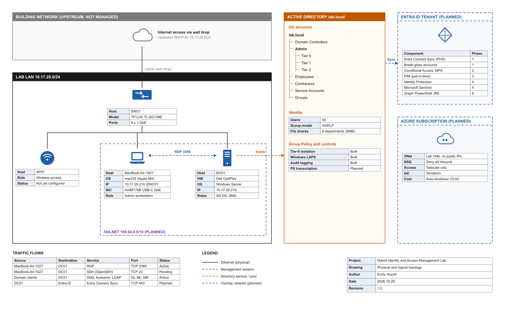

# Hybrid Identity and Access Management Lab

On-premises Active Directory (`lab.local`) built, hardened, and documented as the foundation for a hybrid identity environment with Microsoft Entra ID.



## Current state

| Area | Status |
|---|---|
| Physical lab LAN (TL-SG108E switch, DC01 on OptiPlex) | Built |
| AD DS and DNS for `lab.local` | Built |
| Tiered OU model (Tier 0 / 1 / 2) | Built |
| 50 users, AGDLP groups, 8 department SMB shares | Built |
| Windows LAPS, audit logging, Tier-0 isolation GPO | Built |
| NetBird access to HackUCF OpenStack | Built |
| Entra Connect Sync (PHS + Seamless SSO) | Planned |
| Conditional Access and MFA | Planned |
| Privileged Identity Management | Planned |
| Microsoft Sentinel detections | Planned |
| DC rebuild on OpenStack (Terraform) | In progress |

## Roadmap

1. **Phase 0:** On-prem AD foundation (done)
2. **Phase 1:** Hybrid sync to Entra ID, break-glass accounts
3. **Phase 2:** Conditional Access and MFA
4. **Phase 3:** PIM, just-in-time admin access
5. **Phase 4:** Identity Protection and Sentinel detections
6. **Phase 5:** Simulated attacks (password spray, privilege escalation) and detection
7. **Phase 6:** Automation with Graph PowerShell and Terraform

## Repository layout

```
diagrams/   Topology diagram (PNG, SVG, editable Excalidraw) and the script that generates it
openstack/  Terraform for the DC on HackUCF OpenStack (PCV2)
terraform/  Terraform for Entra ID users and groups
bootstrap/  AD rebuild scripts (export/ is gitignored)
```

## Author

Emily Huynh
